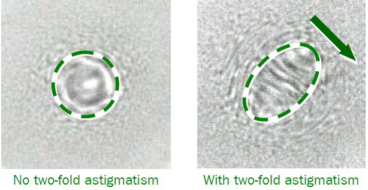

# Begin Observation and Find ROI
You can find the ROI in TEM mode as described previously. Do quick alignments in TEM mode to make sure the beam is reasonably aligned. 

# Switching from TEM to STEM
1. Converge the electron beam with the BRIGHTNESS knob.
2. Align the electron beam spot to the center of the fluorescent screen with Bright Tilt selected and xthe SHIFT X, Y knobs.
3. Open the Operation Mode setting menu from the Operation link in the Detector/Aperture tab panel.
4. Select Scanning in "Operation Mode" in the Detectors/Apertures panel of TEM Center. Lens setting is set to the scanning image observation mode.

# Ronchigram aligment
After moving the operation mode to Scanning, the GUI will change. 
1. In the Scan tab of TEM Center, make sure you are in spot mode. This will park the beam in one position. 
2. Then in the Scan tab, press the Ronchigram button. You can insert a large C2 aperture. 
3. Move the stage till an amorphous region is under the beam. 
4. Press the STD FOCUS button on the right hand panel twice. 
5. Adjust stage Z height up or down to increase the "magnification" of the shadow image you see in the ronchigram. In ideal circumstances, this shadow image should have infinite magnification. 
6. Once the z height is such that the magnification is nearly infinite, correct 2 fold stigmation by pressing the CL STIG button on the left hand panel, and using the DEF/STIG X/Y knobs. 
7. Activate the OL wobble in the wobbler window. The center of the Ronchigram (flat, uniform region) should be the center of convergence. If not, use the DEF/STIG knobs to adjust this. 
8. Disable the OL wobble. 
9. Center the ronchigram on the fluorescent screen camera using PLA (on left hand panel) and DEF/STIG knobs.
10. Insert the desired (normally 40um) condenser aperture and position it concentrically around the flat part of the ronchigram. 

# Viewing STEM images    
1. Open the Camera Length setting window from the Camera Length in the Detector/Aperture tab panel and select a value suitable for the purpose of viewing images.
2. Insert the DF and/or the BF detector using the BF and DF buttons in the TEM schematic in TEM Center Detectors / Apertures tab. 
3. Under the Scan menu, activate the "Full Scan", which will start the scan coils. 
4. Under View menu, select Scan DFI Upper for HAADF, and Scan BFI Bottom for bright field STEM imaging. New popup windows will appear. If a "pause" icon is present in the top left corner of the pop up windows, it means that even through the beam is scanning, the detector data is not being read live. Click that button and it will start showing a live image. 
5. Choose the appropriate pixel time (typically 10us per pixel) and scan size (typically 1k x 1k pixels)
6. You can adjust magnification with the knob on the right hand panel. You will probably have to adjust brightness and contrast (aka offset and gain on the detector). You can do this in software, or you can use the knobs on the right hand panel. The settings on the hand panel will change depending on which detector view window is selected in TEM Center. 

# Saving STEM images
While you can do this in TEM Center, it is much easier to do this in Gatan GMS, to the point where I will not bother writing this section of the manual. I never really endorse Gatan products, but with a heavy heart, I am doing so in this case. 

 