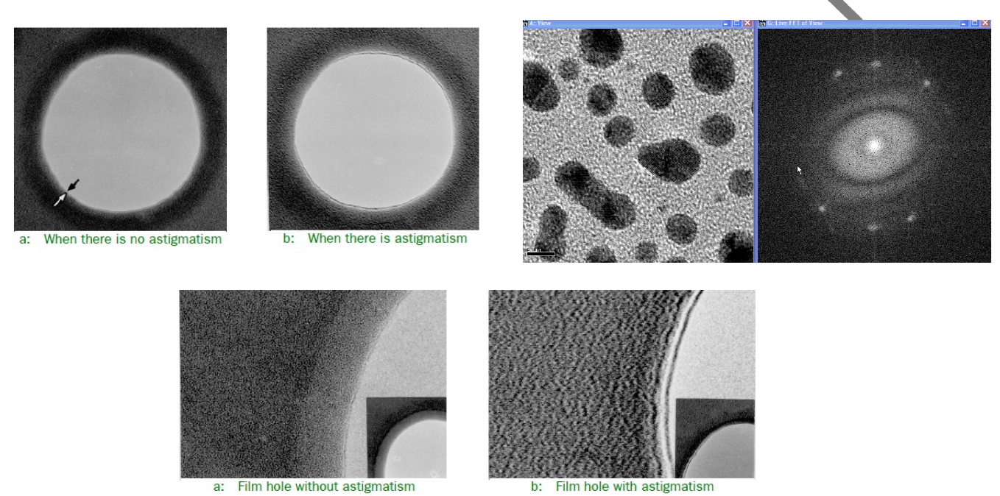

# Basic TEM Alignment Procedures

It makes sens to start your oberservation in TEM mode. Finding the specimen is much easier in TEM mode. Also, switching back and forth between TEM and STEM should not disturb alignments significantly. 

## Start Viewing
1. Only if column vacuum (SIP3) is below 4E-5Pa, press the beam button to open the column valve. 
2. Click on "Cam" in the TEM Center Detectors/Apertures panel to see the fluorescent screen camera image. If nothing pops up, go to View (top menu bar), and check that "Large Screen Camera" is enabled. 
3. Insert a C2 aperture and [center it](./subprocesses/Centering_C2_Aperture.md).
4. Go to Spot 1, Alpha 1. 
5. Push the std focus button. 
6. View the image on the fluorescent screen and bring the image into focus using [Z height](Z height.md). You can use the image wobbler to make this easier. 

## Pre specimen column alignment: setup illumination, find Z height, center C2 aperture and HT center

1. Picking the Spot and Angle number : The spot (1-5) moves the crossover between the gun and C1 lens, and is used to adjust the beam current. The angle selector moves the crossover between C3 and C-mini lens, which decides at what magnification you can have parallel illumination. 

If you select the button "Convergent Mag Link" and "Brightness Mag Link" using the check box in "Illumination Details" in the Detectors/Apertures panel in TEM Center, F200 will automatically change Angle dedending on illumination conditions, but this can cause the beam to disappear.

| Angle | Magnification Range |
|-------|:-------------------:|
| 1     | > 300kX             |
| 2     | 80kX - 250kX        |
| 3     | 30kX - 60kX         |
| 4     | 5kX - 25kX          |
| 5     | <4kX                |

If your desired conditions do not give you a visible beam on the screen, and your sample is not blocking the beam, you can move to a smaller spot size number (larger beam current). 

2. Press the standard focus button, and adjust [Z height](Z height.md). 
3. Insert the largest C2 aperture and [center it](Centering C2 Aperture.md).
4. [Adjust Condenser Stigmation](subprocesses\Condenser Stigmation.md) by clicking the Cond Stig button on the left hand panel, and using the DEF/STIG buttons on the left and right hand panels. Make the illuminated area as round as possible on either side of crossover. If this alignment is not looking OK, do the best you can and revsiit this after adjusting the voltage center. 
5. Adjust [Tilt balance](Tilt Balance.md).
6. Follow the procedure for [voltage centering](Voltage Centering.md).
   
## Objective stigmation
This alignment is needed hor high resolution TEM and needs a reasonably thin amorphous specimen. The stage should also not be drifting too much and the sample should be stable under electron beam radiation. The workflow involves imaging the amorphous specimen on a camera, and make sure the fourier transform of the image has rotational symmetry. 

1. Find a suitable amorphous region.
2. Set the magnification to ~ 300 to 600kX.
3. Image the specimen on the clearview camera, and under start a live FFT in GMS by navigating to process-> life->FFT.
4. Change the defocus till you see 2-3 orders of rings in the FFT.
5. Select the OBJ STIG button on the left hand panel, and adjust the DEF/STIG knobs till the rings are circular. You can make a ellicptial annotation on the FFT and hold down the shift key while making the annotation. This will force the ellipse to be circular and this circle can serve as a guide to judge ellipticity of the FFT. 
6. Adjust the defocus such that you see only 1 ring in the FFT and adjust objective stigmation if needed. 

## Diffraction and BF/DF imaging

This alignment is only needed if you want to do high contrast TEM. Inserting an objective aperture will cut off the electrons scattered to high angles, which contain the high spatial frequency information needed to reconstrust an atomic resolution TEM image. However, for  BF/DF imaging where diffraction contrast needs to be maximized, this is very useful. 

1. Insert an appropritate SAD aperture. 
2. Go into Diffraction mode by pushing the DIFF button on the right hand console. 
3. Insert a high contrast (HC) aperture using either the touchscreen panel above the left hand console, or the Detectors/Apertures window in TEM Center.
4. Sharpen the direct beam with the brightness knob-- this is essentially making sure your beam is parallel and not convergent or divergent. Do not do this with Diff Focus. Diff focus should not have to be changed from the default. Adjusting diff focus to sharpen the HC aperture doesnt work since the HC aperture is not physically in the back focal plane.  
5. Insert the HC aperture using the touchscreen panel above the left hand panel. Move the HC aperture so that it is centered around the direct beam. If you want to do dirty dark field imaging, move the HC aperture till it is positioned around a specific Bragg reflection. 
6. Return to MAG mode and retract the SAD aperture. You now have a bright field image or a dirty dark field image of your sample.
7. While imaging a DF image, you will likely need large binning and long exposure times.  

## HRTEM
Do all the alignments in the above sections, but work at spot 2 or 3, alpha 1, and at a high magnification of 400kX. Pay special attention to 

## Diffraction
1. Align the column as described above. Go to a magnification of 30-50kX, and insert a select area aperture around the region of interest. 
2. Spread the brighness knob all the way clockwise (this should be close to parallel beam condition) and press the diffraction button on the right hand panel. 
3. Choose the appropriate camera length in TEM Center (next to the microscope schematic). 
4. Observe the diffraction pattern on the fluoresent screen. If the central spot is too intense, use the beam stop ("BS" button in TEM Center) before putting the pattern on the camera. 

## Dark Field TEM
1. Align the optical axis as described above. 
2. Bring sample into focus using Z height adjustment.
3. Confirm [voltage center](Voltage Centering.md).
4. Insert a SAD aperture, select DIFF on the right hand panel, and center the diffraction pattern using PLA on the left hand panel and adjusting the DEF/STIG knobs. 
5. Select Dark Tilt and center the direct beam using DEF/STIG.
6. Select Bright Tilt and center the direct beam using DEF/STIG. 
7. Repeat 5-6 till the diffraction pattern does not move as you toggle between bright tilt and dark tilt. This invariably will introduce some beam tilt into the column. 
8. While in DIFF mode, go to std focus (by double tapping on the button on the right hand panel), and sharpen the central spot in the diffraction pattern using the brighness knob (ie, you are creating a parallel beam).
9.  Select dark tilt, and use the DEF/STIG knobs to center the desired diffraction spot. 
10. Insert the HC aperture and center it about the desired spot. 
11. Switch to MAG mode and retract the SAD aperture. 
12. Focus and record.

PS-- you can also tilt the stage in addition to the beam to use 2-beam imaging. 

# Recording and saving images

The Gatan Clearview Camera is used for TEM and parallel beam diffraction. This camera is accessed via a dedicated computer (known as the Gatan PC). Typically, you will find the left side monitor will be connected to the Gatan PC. The mouse and keyboard used to operate the JEOL PC should be useable on the Gatan PC via mouse without borders softwre. The data should all be saved in "S:" on the gatan PC, which is a network drive physically located in the JEOL-Support PC. This PC is connected to the internet and data can be retrieved via 

In order to use the clearview camera :
1. Make sure the microscope is reasonably aligned.
2. Set up a view on the fluorescent screen so that the beam is not too intense, and the region of interest is centered on the field of view at a magnification of interest. 
3. Keep the clearview retracted and the fluorescent screen down.
4. On the tools on the right side of the Gatan GMS software, under TEM imaging, press the view button. Do not insert the camera. Set up an appropriate binning and exposure time. 
5. Make sure the image you observe is random noise, and does not have any artefacts. If there are some obvious burn marks, a new gain and dark correction will need to be done. Call NCEM staff. 
6. If the camera looks OK, make sure the Arina is retracted, and the right click on the Gatan Clear View icon in the left hand microscope schematic in GMS, and press "Insert". 
7. Raise the fluorescent screen in TEM center or using the right hand panel. 
8. You should not see an image on the camera. Make sure the plastic cover for the viewing window on the TEM is in use. Otherwise, room lights seem to affect the signal significantly. 
9. If doing diffraction, you can insert a beam stop using "BS" button in the TEM Center software (in the microscope schematic). You can move the beamstop by double clicking on the BS icon. This stop is under the fluorescent screen, so it is hard to know if the beam will be centered on the stop when you see it on the camera. So, be careful when doing diffraction, and start with a very small exposure time and binning of 1. 
10. Set up the correct binning and exposure time on the acquire settings and press acquire. Be careful not to over-expose the camera as that can cause permanent sensor damage. 
    
## Saving data    
The data should be moved in to a separate workspace. You can now navigate to the tab for the new workspace, and save individual files. ALternatively, you could save the entire workspace with multiple images in it. The data should be saved in "S:", which is a mapped network drive. The drive and data are physically located in the F200-support PC. 