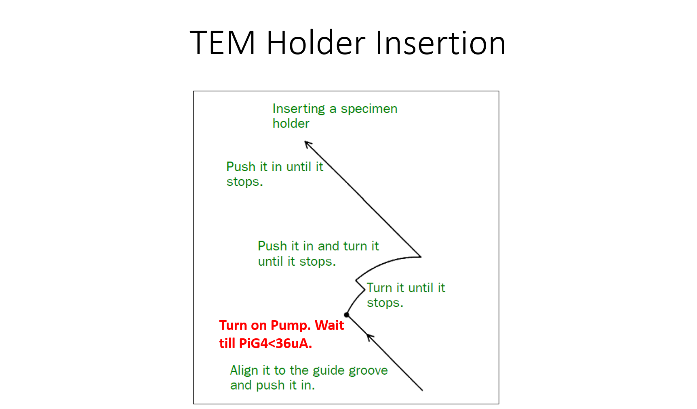

# Loading a TEM holder into the TEM

Once a sample has been loaded onto a TEM holder, the holder can be loaded into the microscope using either manual mode, or using the automated specporter. 

## Loading holders manually

1. Ensure the third (bottom) button on the goiniometer panel says "Manual".  This means the holder will be loaded manually.
2. Align the holder mini pin with the groove at the 9-o clock position, and insert the holder till you reach a physical stop.
3. Push the button which says "Air" on the goiniometer panel. This will change the button to pump, and the DP will start pumping on the TEM holder. The pressure to observe is PiG4 in the "Valve Vacuum Monitor" page. Because V8 and V21 should be open (green), PiG4 will drop over time.
4. Once PiG4 reaches 36uA, the holder can be inserted into the column. To do this, you need to follow this sequence:
  a) do a short clockwise turn till you reach a physical stop,
  b) short insertion till you reach a physical stop,
  c) long clockwise turn till you reach a physical stop,
  d) long insertion till holder is in the column.

