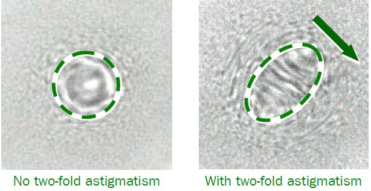

## STEM Mode Setup  
1. Change the mode from TEM to Scanning in the operation window in the microscope drawing in TEM Center.
2. Insert C2 aperture 1 or 2. 
3. Select the appropriate spot size-- spot 5 is good for EDS, spot 8 is good for high resolution. 
4. Select magnification of 1Mx. 
5. Select scan -> ronchigram in the TEM Center menu. This will use the fluorescent screen camera.
6. Select camera length of 1000mm. 
7. Double click on the STD Focus button on the right hand panel.
8. Position the beam over an amorphous sample.
9. Adjust Z till you can see a ronchigram. If you dont see anything, insert a larger C2 aperture. 
10. Turn on PLA and using DEF/STIG knobs, center the ronchigram on the fluorescent screen. 
11. Correct 2 fold stigmation in the ronchigram using the DEF/STIG knobs when COND STIG is selected on the left hand panel. 
12. Use the OL wobbler (using the TEM Center Wobblers page), and confirm rotation center (center of convergence and divergence) is centered about the flat part of the ronchigram. If not, select bright tilt and and adjust the DEF/STIG knobs till that is true. 
13. Center C2 aperture No 3 around the flat part of the ronchigram. 
14. Select 250 mm as the camera length and select the DF detector in the Scan menu. 

## Selecting detectors 
In STEM, there are 2 detectors: the upper DFI and lower BF STEM detector. The lower detector is below the fluorescent screen, so you can only image on it when the screen is retracted. 

Under the view menu of TEM Center, select the STEM detectors you want to use (Scan DFI Upper and/or Scan DFI lower). 

The pop up windows showing the STEM data from the selected detectors will appear on the screen. Use the play button in the top left corner of the window to start or stop the scan. You can select one of 3 scan setting presets on the right side -- scan, focus, and acquire. Normally, use scan to get the settings right before using acquire. 

Adjust offset and gain on the selected detector. 

Focus on sample using Z height and tune fine focus with the objective focus button on the right hand panel. 