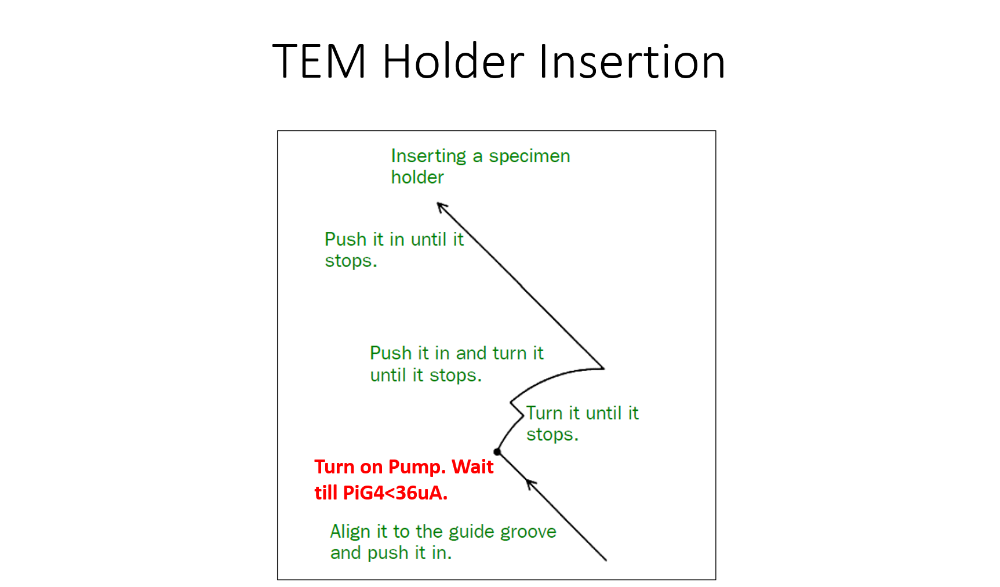

# Loading a TEM holder into the TEM

Once a sample has been loaded onto a TEM holder, the holder can be loaded into the microscope using either manual mode, or using the automated specporter. 

## Loading Samples into Single Tilt TEM Holder
This is relatively easy-- just sligtly loosen the 2 screws, move the copper clamp with tweezers to reveal the 3mm specimen cup. Then place your sample in the cup, and swivel the copper clamp back on top of the sample. Tighten the screws to secure the sample in place.

## Loading Samples into Double Tilt EDS Holder
WARNING: This holder is made using Beryllium metal for X ray transparency. Beryllium can corrode when wet, and is extremely toxic.
1. Partially loosen 2 screws which hold down the copper colored retaining arms with a small flathead screwdriver. Move the retainers away from the sample cup by gently poking them with a tweezer. 
2. Remove the spacer and the specimen plate. These parts are very precious and easily misplaced, so keep them safely on the holder stand, preferrably on the white plastic support chuck for the holder tip. 
3. If there is a sample in the holder, remove that. If not, place your sample in the empty 3mm sample cup. 
4. If using a thin TEM grid (such as a copper mesh grid), place the spacer onto the sample. This is not needed if you are using a SiN grid, which is over 300um thick. 
5. Place the "specimen plate" onto the sample such that the wings of the specimen plate face towards the retaining arms. This plate helps distribute pressure evenly accross your sample. 
6. Place the retaining arms on top of the wings of the specimen plate by gently poking and lifting with a sharp tweezer.
7. Tighten the two screws to finger tightness. 
8. Remove the sample rod from the loading cradle, and flip the rod over to make sure your sample does not fall out. You can gently tap the rod with a tweezer about 1 inch away from the sample region.

## Loading holders manually
**CHECKS BEFORE PROCEEDING : Make sure the Beam Valve is closed, and the goiniometer is set to its neutral position. Make sure the EDS detectors are retracted. Of course, there should be no holder in the goiniometer.  **

1. Ensure the third (bottom) button on the goiniometer panel says "Manual".  This means the holder will be loaded manually.
2. Align the holder mini pin with the groove at the 9-o clock position, and insert the holder till you reach a physical stop.
3. Push the button which says "Air" on the goiniometer panel. This will change the button to "Pump", and the DP will start pumping on the TEM holder. The pump button will be flashing. The pressure to observe is PiG4 in the "Valve Vacuum Monitor" page. Because V8 and V21 should be open (green), PiG4 will drop over time.
4. If using the EDS double tilt holder, plug in the cable for the beta tilt into the goiniometer plug lablled "TL-Y".  
5. Once PiG4 reaches 36uA, the holder can be inserted into the column. To do this, you need to follow this sequence:
  a) do a short clockwise turn till you reach a physical stop,
  b) short insertion till you reach a physical stop,
  c) long clockwise turn till you reach a physical stop,
  d) long insertion till holder is in the column.

## Loading holders using the specporter
**CHECKS BEFORE PROCEEDING : Make sure the holder you are using with the spec porter is correctly calibrated to the load the sample safely. If you are not sure, load the holder manually. **

The specporter is designed to load the TEM holder into the column by moving the goiniometer instead of moving the holder, which is particularly useful when using cryo holders. To load the holder using the specporter, do the following:
1. Make sure the "Auto" button is active on the goiniometer panel. 
2. Align the guide pin with the groove into the goiniometer till you reach a physical stop. This should start the pre-pumping. 
3. Select appropriate holder in the Open Project window in TEM center. The "Specporter OK" logo must be present for the holder to be loaded using the specporter.
4. This should load the holder automatically.

# Retracting a TEM holder