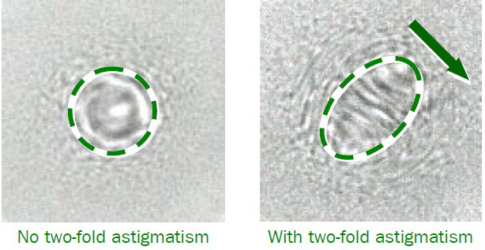

# Begin Observation and Find ROI
You can find the ROI in TEM mode as described previously. Do quick alignments in TEM mode to make sure the beam is reasonably aligned. Alternatively, in TEM Center, you can go to Spot mode (under scan), which stops the beam from scanning. Then, you can click the ronchigram button, which will view the fluorescent screen. When you are out of focus or at wrong Z height, this is basically a poor TEM image, and you can use it for finding your ROI more quickly. Navigate on the stage using the trackball, and then adjust z heigt after you are close to the desired ROI.  

# Switching from TEM to STEM
1. Converge the electron beam with the BRIGHTNESS knob.
2. Align the electron beam spot to the center of the fluorescent screen with Bright Tilt selected and xthe SHIFT X, Y knobs.
3. Open the Operation Mode setting menu from the Operation link in the Detector/Aperture tab panel.
4. Select Scanning in "Operation Mode" in the Detectors/Apertures panel of TEM Center. Lens setting is set to the scanning image observation mode.

# Ronchigram aligment
After moving the operation mode to Scanning, the GUI will change. 
1. In the Scan tab of TEM Center, under `Scan Mode`, make sure you are in spot mode. This will park the beam in one position. 
2. Then in the Scan tab, press the `Ronchigram` button. You should see the ronchigram on the "Large screen camera". Go to the largest camera length and center the beam with PLA sected on the left hand panel, using the bottom 2 (Def/Stig) knobs. To make things easier, you can insert a large C2 aperture (100 or 200 um). 
3. Move the stage till an amorphous region is under the beam. 
4. Double press the STD FOCUS button on the right hand panel . 
5. Adjust stage Z height up or down to increase the "magnification" of the shadow image you see in the ronchigram. In ideal circumstances, this shadow image should have infinite magnification. 
6. Once the z height is such that the magnification is nearly infinite, correct 2 fold stigmation by pressing the CL STIG button on the left hand panel, and using the DEF/STIG X/Y knobs. 
7. This alignment is rarely needed: You may however activate the OL wobble in the wobbler window. The wobble window can be found by clicking the Lens/Deflector tab which is under the TEM schematic.  The center of the Ronchigram (flat, uniform region) should be the center of convergence. If not, use the DEF/STIG knobs to adjust this. 
8. Disable the OL wobble. 
9. Center the ronchigram on the fluorescent screen camera using PLA (on left hand panel) and DEF/STIG knobs.
10. Insert the desired (normally 40um) condenser aperture and position it concentrically around the flat part of the ronchigram. 

# Viewing STEM images    
1. Open the Camera Length setting window from the Camera Length in the Detector/Aperture tab panel and select a value suitable for the purpose of viewing images. You may need to re-center the ronchigram with PLA selected, using DEF/STIG knobs.
2. Insert the DF and/or the BF detector using the BF and DF buttons in the TEM schematic in TEM Center Detectors / Apertures tab. 
3. Note for BF, it can be helpful to insert a BF aperature to improve contrast.
4. Under the Scan menu, activate the `Full Scan`, which will start the scan coils. 
5. Under View menu, select Scan DFI Upper for HAADF, and Scan BFI Bottom for bright field STEM imaging. New popup windows will appear. If a "pause" icon is present in the top left corner of the pop up windows, it means that even through the beam is scanning, the detector data is not being read live. Click that button and it will start showing a live image. 
6. Choose the appropriate pixel time (typically 10us per pixel) and scan size (typically 1k x 1k pixels)
7. Start at low magnification of about 10kX, and adjust the brighness (detector offset) and contrast (detector gain) using knobs on the right hand panel while viewing the image.  You can adjust magnification with the knob on the right hand panel. The settings on the hand panel will change depending on which detector view window is selected in TEM Center. 
8. Adjust focus using the right hand panel to improve the sharpness of the image

# Choosing STEM parameters

# Acquiring STEM images : Using TEM Center

This GUI is clunky and not easy to use, but if you insist on being miserable, you can follow these steps: 

1. Set up your name and folder: at the bottom of TEM center there is a panel that says `Name` with a hyperlinked generated name below. Click on that to set-up your image saving options. You can specify automatic naming and if you want a tif, jpeg or both. Scroll down to the bottom of the pop-up and hit `ok`.
2. Acquisition parameters can be modified by clicking on `scan settings` in the `Image Information` panel. This allows you to change dwell time and pixels. 
3. There are two cpature buttons: one with a camera that let's you capture with currently selected scanning detector, and one with a camera with a line through it that let's you capture from all scanning detectors. The second is helpful if you want to acquire with bright field and dark field at the same time. 
4. Annotations from measurements are saved in image. 
5. After recording your first image, check that it has saved properly in the location you specified. 
6. In the `scan settings` pop up there options for time series and defocus series. It's in a drop down menu usually set as `Single` in the `Series Capture` panel.

# Acquiring STEM images : Using Gatan Digital Micrograph

1. Switch the mouse to the left monitor and open GMS Digital Micrograph. 
2. Make sure you select "yes" when it asks you if you want to load certain plugins. 

## STEM HAADF imaging
1. In Technique Manager (which you can open by clicking the home button on the right side of the DM window), select the STEM SI technique which displays panels for both EDS mapping and STEM imaging. 
2. Press `View` under `Scan` to start viewing the HAADF image. 
3. Press the `Capture` button to acquire a STEM HAADF image. If you dont see this button, click the small triangle next to the `view` button to reveal it. 

## STEM EDS mapping
Refer to the EDS mapping [manual](05-EDS.md).

## Saving data

Data should be saved on the mapped network drive (mapped as S:). This drive is physically located on the support PC.